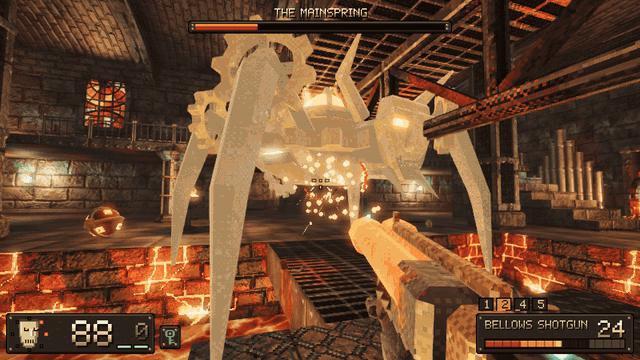
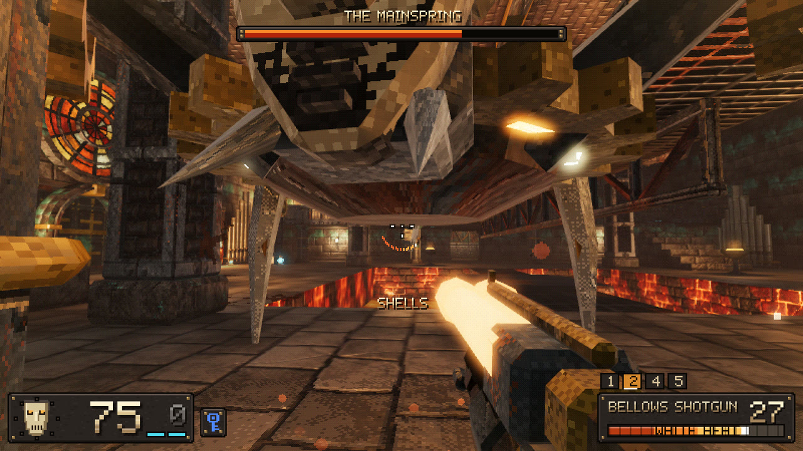
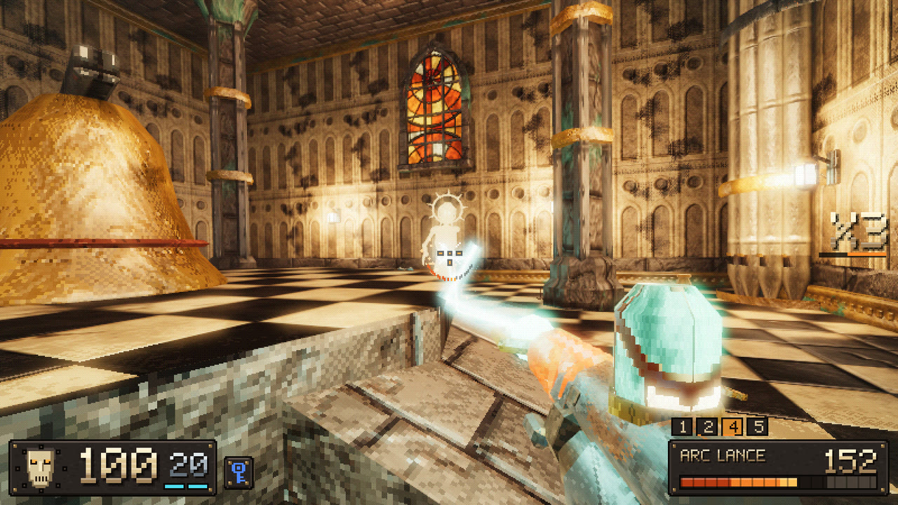
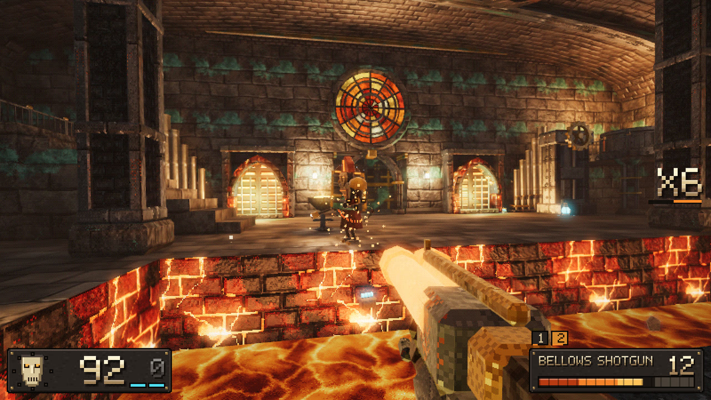

# Furnace Choir

A fast retro first-person shooter in Babylon.js and TypeScript. A cannon foundry prayed to its furnaces until they answered, and now its machines sing. Your gun gets stronger the hotter it runs, until it vents.

[](https://oryn.dev/games/furnace-choir)

**[Play it in your browser](https://oryn.dev/games/furnace-choir)**, no download needed. It also runs on phones.

## What is inside

- One hand-built level, The Casting Pit, with a boss fight, two secrets and a par time to beat
- Six weapons with a second fire each (rivet pistol, bellows shotgun, blade launcher, arc lance, slag mortar, the Bell) and a hammer
- Heat as the core rule: hot barrels hit harder, and a full bar vents and stuns everything close to you
- Seven kinds of machines plus The Mainspring, three difficulties, checkpoints and a score chain
- A chunky pixel look made in shaders, with baked level light and procedural textures
- Keyboard and mouse, gamepad and touch, all remapped in one small controls file

<p>
  
  
  
</p>

## Start it on your computer

You need [Node.js](https://nodejs.org) 20.19 or newer.

```bash
git clone https://github.com/oryn-dev/babylonjs-boomer-shooter.git
cd babylonjs-boomer-shooter
npm install
npm run dev
```

Then open the address it prints, usually http://localhost:5173.

`npm run build` writes the finished game to `dist/`. It is a plain static folder, so you can put it on any web host or upload it to itch.io as an HTML game.

## Controls

| | Keyboard and mouse | Gamepad | Touch |
| --- | --- | --- | --- |
| Move | W A S D | Left stick | Left thumb |
| Look | Mouse | Right stick | Drag on the right |
| Fire / second fire | Left / right mouse | RT / LT | Fire buttons (auto fire is an option) |
| Jump / dash | Space / Shift | A / B | Arrow buttons |
| Hammer | Q | RB | Hammer button |
| Weapons | 1 to 6 or wheel | Y, LB | Swap, hold for the wheel |
| Use | E | X | Use button |
| Pause | Esc or P | Start | Pause button |

## Change it

| File | What it does |
| --- | --- |
| `src/game/game.ts` | Where the game starts |
| `src/game/level/maps/pit.ts` | The level: rooms, lights, items, enemies and the boss |
| `src/game/play/arsenal.ts` | The weapons |
| `src/game/foes/` | The machines and the boss |
| `src/game/play/controls.ts` | Keyboard, mouse, gamepad and touch |
| `src/game/gfx/` | Shaders, pixel look, particles |
| `game/tuning.json` | 37 values such as damage, heat and speed |
| `game/look.json` | Sky, light, fog and post effects |
| `public/assets/` | Models, textures, sounds and fonts |
| `src/oryn/` | A small base around Babylon.js: start, light, input, sound, saves, settings |

`npm run typecheck` checks the types.

## Open it in Oryn

The project follows the layout of [Oryn](https://oryn.dev), so you can open it there and keep building by chat, with the game running next to it.

1. Sign in at [oryn.dev](https://oryn.dev) and start a new game.
2. Choose **From GitHub** in the menu next to the prompt.
3. Paste `https://github.com/oryn-dev/babylonjs-boomer-shooter` as the public repository URL and press **Import project**.

You get your own copy. This repository stays as it is.

## Make it yours

A few things you could ask for after the import:

- "Add a second level in a flooded bell foundry with moving platforms"
- "Make a weapon that freezes machines for three seconds"
- "Turn this into an endless arena with waves and a high score"

When you like the result, publish it as a page anyone can play, or export it as a [mobile app](https://oryn.dev/mobile-game-maker) for Android and iOS or as a Windows, Mac, Linux or Steam build. Exports need a paid plan, and you publish with your own store accounts.

## More games with source

- [Moth Hour](https://github.com/oryn-dev/babylonjs-bullet-hell), a bullet hell
- [Deep Salvage](https://github.com/oryn-dev/babylonjs-submarine-game), a submarine game
- [Channel 6: Night Shift](https://github.com/oryn-dev/babylonjs-horror-game), a horror game
- [Tornado Simulator: Storm County](https://github.com/oryn-dev/babylonjs-tornado-simulator), a tornado simulator

## License

The code and our own assets are [MIT](LICENSE): use them, change them, sell what you make. Third-party assets and libraries are listed in [ASSETS.md](ASSETS.md). The Oryn name and logo are not part of the license.
